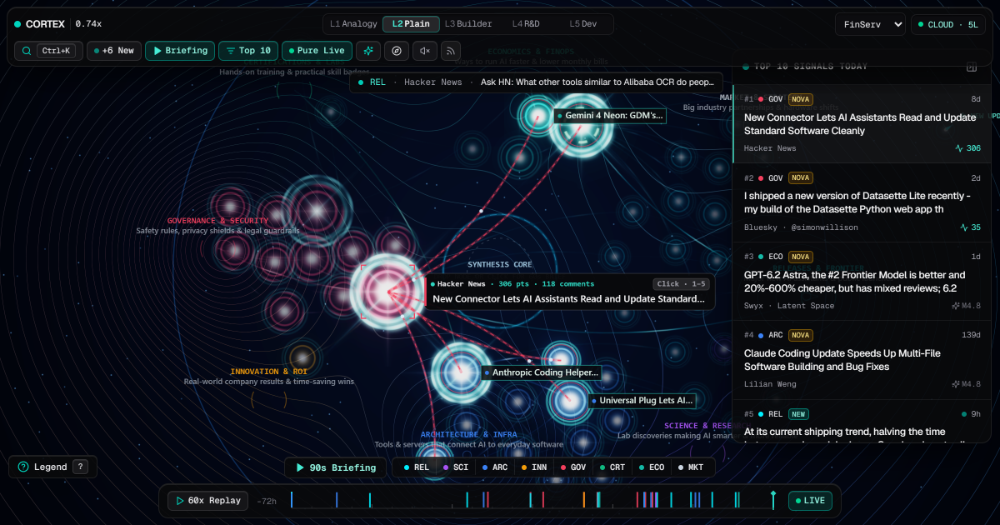

<div align="center">

# CORTEX // NEXUS
### Real-Time Spatial AI Intelligence & Consultant Command Deck

[](https://cortex-radar.github.io/)
[](https://ollama.com)
[](https://www.typescriptlang.org/)
[](https://vite.dev/)

<br />

<a href="https://cortex-radar.github.io/">
  
</a>

<p align="center">
  <strong>Explore the Live Serverless Radar:</strong>
  <a href="https://cortex-radar.github.io/">https://cortex-radar.github.io/</a>
</p>

</div>

---

## Overview

**CORTEX // NEXUS** is a real-time spatial AI intelligence deck engineered for builders, principal architects, and enterprise AI strategists. Instead of drowning in fragmented RSS readers, benchmark threads, and launch hype, CORTEX projects live AI breakthroughs onto an interactive orbital radar—clustering cross-network **Supernovas**, scoring **Launch Hype vs. Engineer Street Consensus**, and translating every signal on demand across a **5-Level Universal AI Literacy Spectrum (L1–L5)**.

---

## Flagship Capabilities

| Capability | What It Delivers |
| :--- | :--- |
| **Spatial Orbital Radar & Supernova Clustering** | Maps live signals across 8 strategic sectors (`REL`, `SCI`, `ARC`, `INN`, `GOV`, `CRT`, `ECO`, `MKT`) with real-time velocity rings and cross-source Supernova fusion. |
| **L1–L5 Universal Literacy Spectrum** | Translates any paper, model drop, or kernel patch across 5 personas: **L1 Zero-Jargon** (everyday analogy), **L2 Plain English**, **L3 Builder Bridge** (interactive glossary), **L4 Consultant ROI** (FinOps, readiness & client advisory), and **L5 Frontier Pro** (bare-metal specs & street caveats). |
| **Hype vs. Street Verdict Engine** | Contrasts viral launch claims against top-upvoted engineering replies from `r/LocalLLaMA`, `r/MachineLearning`, `r/AI_Agents`, `r/Rag`, Hacker News, and Discord `#announcements`. |
| **Live Model Battlecards & Industry Lenses** | Instant executive comparison matrices and tailored FinOps/risk advisories across Banking, Healthcare, Retail, FinOps, Public Sector, and SaaS. |
| **Tri-Engine Synthesis Switchboard** | Seamlessly routes synthesis between **Local Ollama GPU** (`$0` private inference), **Google Gemini 2.5 Flash**, and a **1ms Deterministic Rule Engine** fallback. |

---

## Zero-Key Multi-Source Telemetry

CORTEX ingests and enriches live upstream signals out of the box with **$0 API key requirements**:

- **Frontier Research:** `arXiv` (`cs.AI`, `cs.CL`, `cs.LG` with automatic HTML Figure 1 extraction) & **Hugging Face Daily Papers**.
- **Builder & Lab Streams:** **Hacker News** Algolia AI/MCP stream, **GitHub** trending `mcp` & `ai-agents` repositories, and official AI lab feeds.
- **VIP Voices & Bluesky AppView:** Andrej Karpathy, Simon Willison, Ethan Mollick, Swyx (Latent Space), Nathan Lambert, and Lilian Weng via RSS + public Bluesky XRPC feeds.
- **Underground Street Adapters:**
  - **Deep Reddit Street Engine:** Polls 12 AI engineering subreddits (`/hot` + `/rising` + top-5 engineer comments) with automatic ArcticShift mirror failover.
  - **Discord Live Relay:** `discord.js` Gateway WebSocket listener + instant `#announcements` webhook relay.
  - **Local Playwright X Scraper:** Optional local session-cookie Chromium worker for high-signal benchmark/release threads.

---

## Quickstart (Local Full-Stack + Ollama GPU)

Running CORTEX locally unlocks live SSE streaming, the Underground Switchboard, and `$0` local GPU synthesis via **Ollama**.

### 1. Start Ollama & Pull a Local Model

Install [Ollama](https://ollama.com) (`http://127.0.0.1:11434`) and pull the recommended 12GB-VRAM-friendly model:

```bash
ollama pull qwen2.5:7b
ollama serve
```

> CORTEX automatically probes `http://127.0.0.1:11434/api/tags` on startup, detects `qwen2.5:7b` (or Llama/Gemma/DeepSeek weights), upgrades synthesis from deterministic rules to local GPU inference, and prewarms top orbital nodes in the background.

### 2. Install Dependencies & Launch

```bash
git clone https://github.com/cortex-radar/cortex-radar.github.io.git
cd cortex-radar.github.io
npm install
npm run dev
```

- **Spatial Radar Client (Vite):** `http://localhost:5173`
- **Telemetry & Synthesis API (Express):** `http://127.0.0.1:3001`

### 3. Optional Environment Overrides (`.env.local`)

No keys are required to boot. To pin a specific Ollama model or enable optional cloud/social adapters, create `.env.local`:

```ini
OLLAMA_MODEL="qwen2.5:7b"
GEMINI_API_KEY=""          # Optional: enables Gemini 2.5 Flash synthesis engine
DISCORD_BOT_TOKEN=""       # Optional: live Discord guild #announcements relay
```

---

## Production Build & Serverless Galaxy Baker

The live GitHub Pages deployment ([cortex-radar.github.io](https://cortex-radar.github.io/)) runs an automated GitHub Actions cron pipeline every 3 hours (`scripts/bakeStaticGalaxy.ts`) that pre-bakes fresh upstream signals and L1–L5 literacy payloads into `public/data/live-galaxy.json`.

```bash
# Refresh static galaxy snapshot locally
npm run bake:galaxy

# Type-check & build production bundle into ./dist
npx tsc --noEmit && npm run build
```

---

## Architecture

```text
cortex-nexus-ai/
├── src/                    # React 19 + Tailwind v4 spatial radar UI, orb cards & battlecards
├── server/                 # Express SSE server, RSS/arXiv enrichers & Tri-Engine synthesis
│   ├── index.ts            # Upstream feed orchestrator + full-text/OpenGraph extractor
│   ├── undergroundAdapters.ts # Ollama/Gemini/Deterministic router + Reddit/Discord/X adapters
│   └── xPlaywrightWorker.ts   # Local headless Chromium X thread scraper
├── shared/                 # Isomorphic TypeScript contracts, Supernova & L1–L5 literacy engines
├── scripts/
│   └── bakeStaticGalaxy.ts # Zero-cost CI snapshot baker for serverless GitHub Pages
└── public/
    ├── og-banner.png       # 1200x630 OpenGraph / X large-image social preview
    └── data/               # Pre-baked live-galaxy.json snapshot
```
